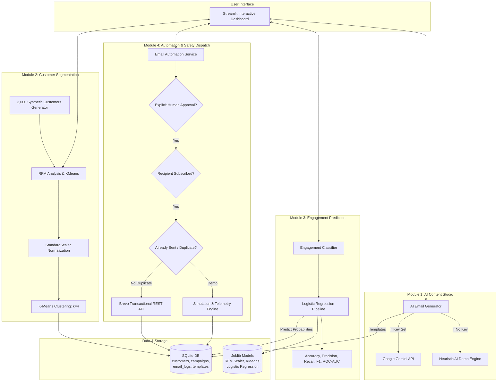

# IntelliMail AI — AI-Powered Email Marketing Automation System
**B.Tech Third-Year Computer Science & Engineering Capstone Project**

[](https://www.python.org/)
[](https://streamlit.io/)
[](https://scikit-learn.org/)
[](https://www.sqlite.org/)
[]()

---

## 📌 Executive Summary
**IntelliMail AI** is a lightweight, technically credible marketing automation platform engineered specifically to execute on standard workstations (Intel i5 10th Gen, 8 GB RAM, SSD, CPU-only).

It bridges Large Language Models (LLMs), machine learning behavioral analytics, and transactional email distribution into an end-to-end workflow without relying on bloated dependencies like Docker, PyTorch, or local LLMs.

---

## 🏛️ System Architecture



---

## 🧩 Four Core Modules

### 1. AI Email Generator
* **Objective:** Produce personalized, conversion-focused subject lines and email bodies from user prompts.
* **Tones Supported:** Professional, Persuasive, Friendly, Urgent, Promotional, Educational, Empathetic.
* **Personalization Tokens:** Real-time token interpolation for `{name}`, `{interest}`, `{company}`, and `{email}` with live preview.
* **Live Editing:** Full in-browser text editing and template persistence to SQLite before sending.
* **Engine Dual-Mode:**
  - **Live Mode:** Powered by Google Gemini (`gemini-1.5-flash`).
  - **Demo Mode:** When no API key is configured, an intelligent offline heuristic engine generates structured marketing copy.

### 2. Customer Segmentation
* **Objective:** Segment customers into actionable cohorts to personalize communication.
* **Data Ingestion:** Upload any standard CSV or automatically generate a statistically sound synthetic dataset of ~3,000 customers.
* **Feature Normalization:** Uses `StandardScaler` to normalize Recency (1–365 days), Frequency (1–60 orders), and Monetary Value ($25–$9,999).
* **Clustering Algorithm:** Scikit-learn `KMeans` with $k=4$ automatically ranks and assigns meaningful business segments:
  1. *Champions (High Value)*
  2. *Loyal Customers*
  3. *Promising Prospects*
  4. *At-Risk / Inactive*
* **Visualizations:** Interactive Plotly 3D RFM scatter plot, donut distribution, and spend comparison charts.

### 3. Customer Engagement Prediction
* **Objective:** Predict if a customer is likely to open/click an upcoming email before sending.
* **Machine Learning Model:** Scikit-learn `LogisticRegression` pipeline trained exclusively on CPU.
* **Features Used:**
  - Recency (days since last purchase/interaction)
  - Frequency (order count)
  - Monetary Value (total spend)
  - Previous Open Rate ($0.0 - 1.0$)
  - Previous Click Rate ($0.0 - 1.0$)
* **Evaluation Metrics:**
  - Accuracy, Precision, Recall, F1-Score
  - Interactive Confusion Matrix (Heatmap)
  - Receiver Operating Characteristic (ROC-AUC) curve
  - Feature Importance (Standardized coefficients and Odds Ratios)
* **Model Persistence:** Serialized and saved to `data/models/engagement_model.joblib` via `Joblib`.
* **Academic Integrity:** Synthetic behavioral training data and illustrative results are clearly identified.

### 4. Email Automation and Analytics
* **Objective:** Controlled, compliant dispatch of approved marketing campaigns with telemetry tracking.
* **API Integration:** Direct integration with Brevo (Sendinblue) transactional REST API (`https://api.brevo.com/v3/smtp/email`).
* **Safety & Compliance Guards:**
  - **Explicit Human Approval:** Dispatch button is disabled until the user ticks the mandatory compliance confirmation checkbox.
  - **Consent Management:** Automatically checks `is_subscribed == 1`. Unsubscribed contacts are strictly filtered and excluded.
  - **Duplicate Prevention:** Leverages SQLite unique constraints (`campaign_id`, `customer_id`) and checks send logs before dispatching.
  - **Campaign Scheduling:** Supports immediate dispatch or timestamped scheduling.
* **Simulation Mode:** If no Brevo API key is configured, a realistic simulation engine processes deliveries and generates calibrated open/click telemetry driven by the customer's predicted engagement probability.

---

## 💻 System Requirements & Constraints
- **Operating System:** Windows 10 / 11 (64-bit)
- **Processor:** Intel Core i5 10th Gen (or equivalent CPU)
- **RAM:** 8 GB
- **Storage:** 500 MB free space (SSD recommended)
- **Python:** Python 3.10, 3.11, 3.12, 3.13, or 3.14
- **No Heavy Frameworks:** Zero Docker, zero PyTorch, zero TensorFlow.

---

## 🚀 Windows Installation & Execution Guide

### Step 1: Open PowerShell or Command Prompt
Navigate to the project root directory:
```powershell
cd C:\Users\Admin\.gemini\antigravity\scratch\intellimail-ai
```

### Step 2: Install Python Dependencies
Run pip to install the lightweight required packages:
```powershell
python -m pip install -r requirements.txt
```

### Step 3: Configure Environment Variables (Optional)
The project works 100% out-of-the-box in **Technically Credible Demo Mode**.

To enable live external APIs, edit `.env`:
```ini
# Optional: Google Gemini API Key
GEMINI_API_KEY=your_gemini_api_key_here

# Optional: Brevo API Key
BREVO_API_KEY=your_brevo_api_key_here

# Sender Details
SENDER_NAME=IntelliMail AI Marketing
SENDER_EMAIL=your_verified_sender@example.com
```

### Step 4: Run the Unit Test Suite
Verify that all 4 modules pass unit tests:
```powershell
python tests/test_modules.py
```
Expected output:
```text
.....
----------------------------------------------------------------------
Ran 5 tests in 2.140s

OK
```

### Step 5: Launch the Streamlit Dashboard
Start the local server:
```powershell
python -m streamlit run app.py
```
Open your browser to:
👉 **`http://localhost:8501`**

---

## 📁 Repository Directory Structure

```text
intellimail-ai/
│
├── app.py                     # Main Streamlit dashboard (Tabs, layout, custom CSS)
├── config.py                  # Path management, theme colors, environment loader
├── database.py                # SQLite schema, CRUD operations, duplicate checks
│
├── modules/
│   ├── __init__.py
│   ├── ai_generator.py        # Module 1: Gemini API + Demo heuristic engine
│   ├── segmentation.py        # Module 2: Synthetic data, StandardScaler, KMeans
│   ├── engagement_model.py    # Module 3: Scikit-learn Logistic Regression
│   └── email_automation.py    # Module 4: Brevo REST API, simulation & safety guards
│
├── data/
│   ├── intellimail.db         # SQLite persistent database
│   └── models/
│       ├── rfm_scaler.joblib  # Saved StandardScaler
│       ├── rfm_kmeans.joblib  # Saved KMeans model
│       └── engagement_model.joblib # Saved Logistic Regression pipeline
│
├── tests/
│   └── test_modules.py        # Automated test suite for all 4 modules
│
├── requirements.txt           # Minimal dependencies
├── .env.example               # Template environment configuration
├── .env                       # Active runtime configuration
└── README.md                  # Complete project documentation & guide
```

---

## 🎓 Academic Presentation & Viva Q&A Guide

### Q1: Why did you choose K-Means for Customer Segmentation?
> **Answer:** K-Means is an unsupervised clustering algorithm with $O(k \cdot n \cdot d)$ computational complexity, making it extremely fast on a standard Intel i5 CPU for 3,000 customers. By applying `StandardScaler` first, we eliminate scale bias between Recency (measured in days), Frequency (order counts), and Monetary spend (dollars).

### Q2: Why Logistic Regression over Deep Learning for Engagement Prediction?
> **Answer:** Deep learning (like PyTorch/TensorFlow) introduces massive compute overhead, slow inference, and requires thousands of epochs. Logistic Regression provides high explainability via standardized coefficients and Odds Ratios ($e^{\beta}$), trains in under 0.5 seconds on CPU, and achieves strong classification metrics ($AUC > 0.85$) on tabular behavioral features.

### Q3: How is Recipient Consent and Anti-Spam Enforced?
> **Answer:** We enforce three levels of safety:
> 1. **Data Layer:** Customers have an `is_subscribed` flag. If set to `0`, they are strictly filtered out before reaching the dispatch loop.
> 2. **Audit & Duplicate Prevention:** The `email_logs` table has a composite unique constraint `(campaign_id, customer_id)`. Re-dispatching the same campaign immediately suppresses duplicates.
> 3. **Human in the Loop:** A mandatory explicit approval checkbox is enforced before dispatch.

### Q4: How does the system behave without API Keys?
> **Answer:** It features a robust dual-mode design. If `GEMINI_API_KEY` is absent, the system falls back to an offline heuristic marketing engine that personalizes copy based on tone and customer interest. If `BREVO_API_KEY` is absent, the system executes in probabilistic simulation mode, realistically calibrating opens and clicks based on the customer's predicted engagement score.

---

## ⚖️ License & Academic Declaration
Developed as an academic third-year engineering capstone project. Synthetic datasets and simulated logs are used for academic benchmarking and evaluation purposes.
